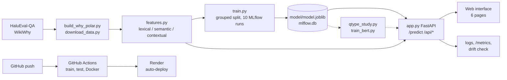
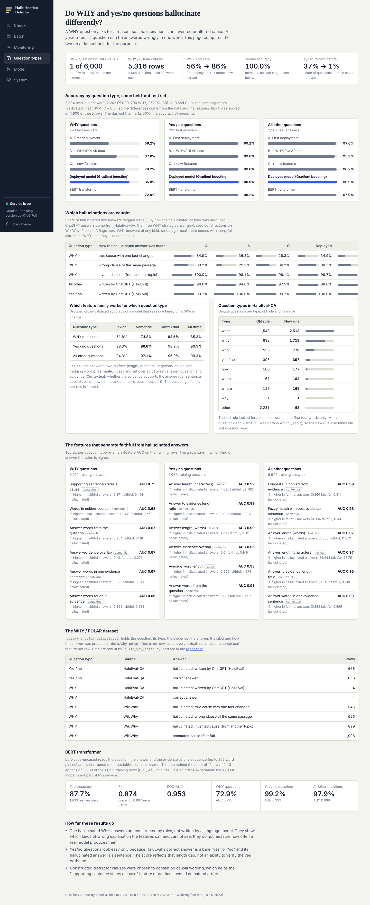
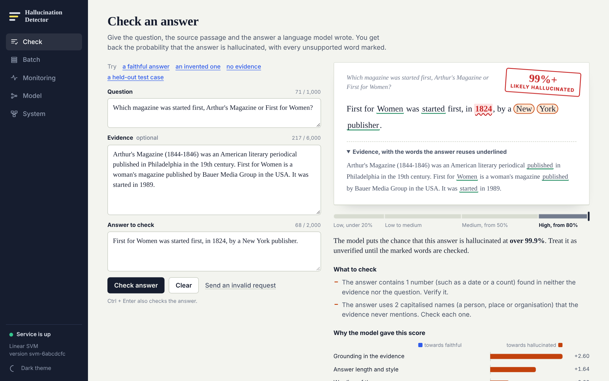
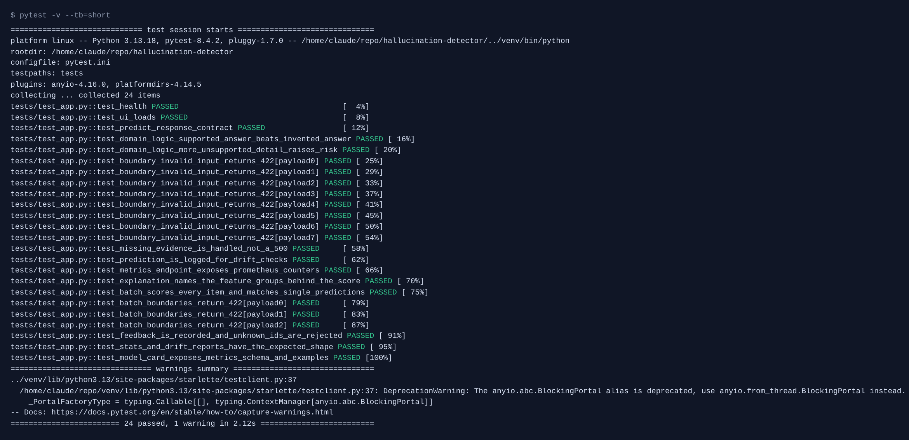
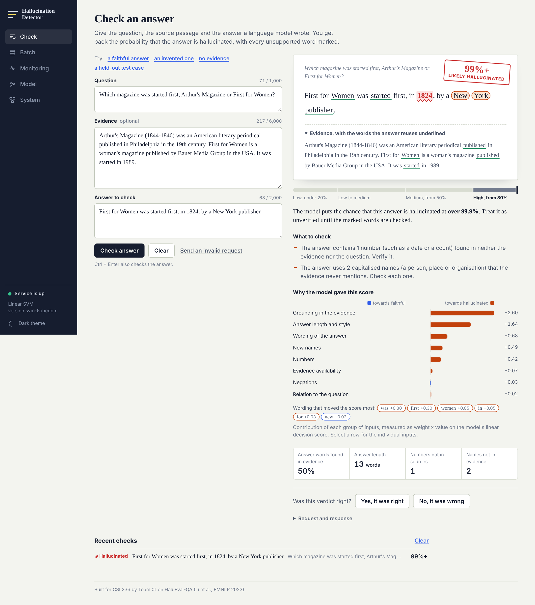
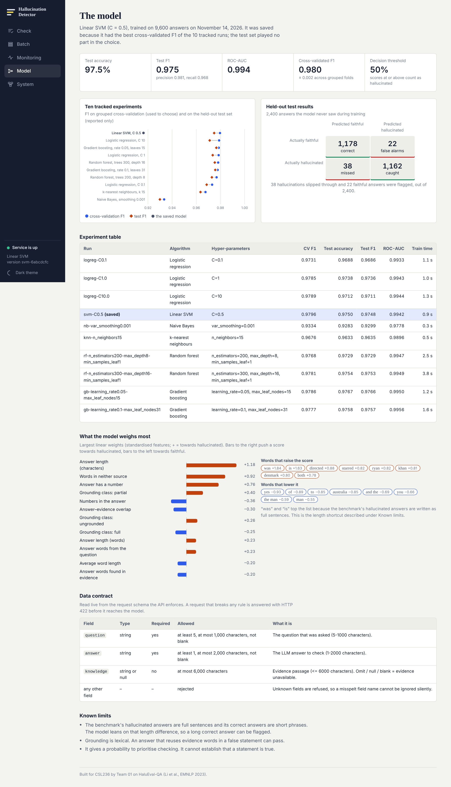
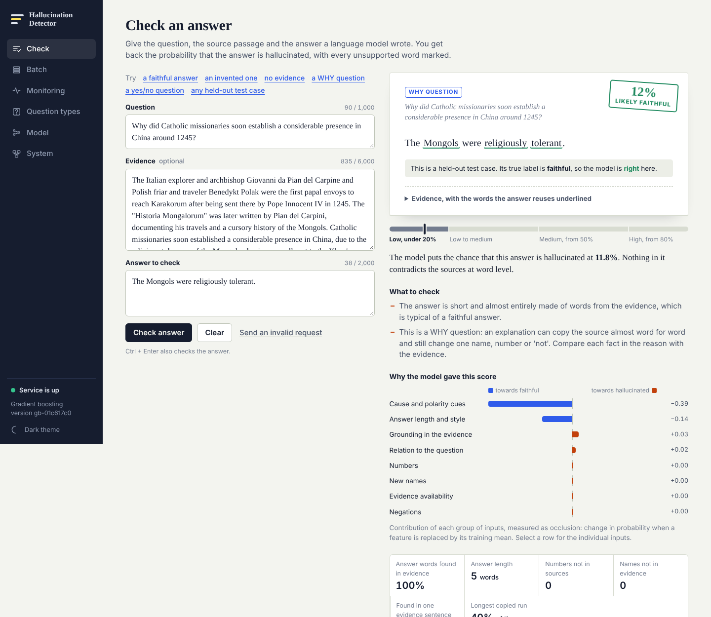

# Hallucination Detector

[](https://github.com/QuantamQuester/hallucination-detector/actions/workflows/ci.yml)
[](https://verimind-6syg.onrender.com/)
  [](LICENSE)

**A service that scores how likely a language model's answer is to be hallucinated**, given the question and an (optional) evidence passage.
Built for CSL236 (Introduction to AI and Machine Learning, The NorthCap University) by Team 01, in three phases:

1. **Mid-term** - a leakage-safe classical-ML study on HaluEval-QA (12,000 balanced rows, six algorithms).
2. **End-term (MLOps)** - the model shipped as a tracked (MLflow), validated (FastAPI + Pydantic), tested (33 pytest cases), containerised (Docker), CI-checked (GitHub Actions) and deployed (Render) service with a six-page web interface.
3. **Research extension** - do **WHY** and **yes/no** questions hallucinate differently? A new dataset, lexical / semantic / contextual features, five pipelines compared on one test set, and a **BERT** baseline.

| | |
|---|---|
| **Team** | 01 - Bhavya Sangwan (24CSU039), Rishika Sharma (24CSU173) |
| **Course** | CSL236 - Introduction to AI and Machine Learning, B.Tech CSE, Semester 5, The NorthCap University |
| **Live app** | <https://verimind-6syg.onrender.com/> (Render, redeploys on every push to `main`) |
| **Repository** | <https://github.com/QuantamQuester/hallucination-detector> |

## Results at a glance
| | Result |
|---|---|
| Mid-term (HaluEval-QA, 2,400 test rows) | best model 97.7 % accuracy, ROC-AUC 0.995 |
| Deployed model (HaluEval-QA + WHY/yes-no data, 3,304 test rows) | gradient boosting: 95.9 % accuracy, F1 0.959, ROC-AUC 0.992 |
| WHY questions, first deployment -> final | **56 % -> 86 %** (yes/no 100 %, other 99 %) |
| Hardest case | a true cause with **one fact changed** is caught only 28-37 % of the time (feature models and reduced BERT alike) |
| Honest limits | the WHY hallucinations are rule-built, yes/no accuracy is mostly a length effect, the BERT run is CPU-sized - see sections 2 and 10 |

## Deliverables
| What | Where |
|---|---|
| **Final notebook** (executed, 151 cells: Part 1 mid-term, Part 2 MLOps, Part 3 question-type study) | [`notebooks/Team01_CSL236_HallucinationDetection_Final.ipynb`](notebooks/Team01_CSL236_HallucinationDetection_Final.ipynb) |
| **Final report** (18 pages, formal) | [`docs/final/Team01_CSL236_Final_Report.pdf`](docs/final/Team01_CSL236_Final_Report.pdf) (+ `.docx`) |
| **Project guide** (plain-language explanation, demo script, viva Q&A) | [`docs/final/Team01_CSL236_Project_Explained.pdf`](docs/final/Team01_CSL236_Project_Explained.pdf) (+ `.docx`) |
| **Final presentation** (12 slides) | [`docs/final/Team01_CSL236_Final_Presentation.pptx`](docs/final/Team01_CSL236_Final_Presentation.pptx) |
| Earlier end-term reports (before the question-type study) | `docs/BhavyaSangwan_24CSU039.pdf`, `docs/RishikaSharma_24CSU173.pdf` |

## How it fits together


## Quick start
```bash
git clone https://github.com/QuantamQuester/hallucination-detector && cd hallucination-detector
python3 -m venv venv && source venv/bin/activate && pip install -r requirements.txt
uvicorn app:app --port 8000        # open http://localhost:8000  (a trained model is already committed)
pytest -q                           # 33 tests
```
Retrain everything: `python build_why_polar.py && python train.py --sweep && python qtype_study.py` (see section 4).
No GPU or Hugging Face access is needed for any of this; only the optional full BERT fine-tuning wants a GPU.

**Contents:** 1 Problem and data contract - 2 Question-type study - 3 Repository layout - 4 Setup and run - 5 MLflow results - 6 Which model and why - 7 Testing - 8 Docker, CI, deployment - 9 Screenshots - 10 Limitations - 11 Team contribution - 12 References

## 1. Problem statement and dataset
Large language models sometimes give fluent answers that are not supported by facts (**hallucinations**). Given a **question**, an optional
**evidence passage** and an **answer**, the service returns the probability that the answer is hallucinated (binary classification, 1 = hallucinated).

**Dataset:** HaluEval-QA - Li, Cheng, Zhao, Nie, Wen (2023), *HaluEval: A Large-Scale Hallucination Evaluation Benchmark for Large Language Models*, EMNLP 2023,
<https://github.com/RUCAIBox/HaluEval> (`data/qa_data.json`, questions derived from HotpotQA). 6,000 questions are sampled (seed 42); each gives one faithful
(label 0) and one hallucinated (label 1) answer -> **12,000 rows, balanced**. `data/halueval_qa.csv` (5.9 MB) is committed; `python download_data.py` rebuilds it.
5 % of the questions have their evidence blanked (seeded **simulation** of a retrieval failure, documented in the mid-term notebook).
Pre-processing and evaluation were done in the mid-term notebook (stages A-H, Part 1 of [`notebooks/`](notebooks/Team01_CSL236_HallucinationDetection_Final.ipynb)); this repo ships that model.
The train/test split (80/20) is **grouped by question** so both answers to one question are never on different sides, and it happens before anything is fitted.

### Data contract (enforced by the Pydantic schema - violations return HTTP 422)
**Request fields**

| Feature | Type | Allowed range / values | Why it matters |
|---|---|---|---|
| `question` | string | 5 - 1000 characters, not blank | Defines what a correct answer must contain; gives the question type and words to compare against |
| `answer` | string | 1 - 2000 characters, not blank | The text being checked: its length, wording and numbers are the strongest signals |
| `knowledge` | string or null | 0 - 6000 characters; null / blank = evidence unavailable | The evidence the answer should be grounded in; missing evidence is imputed and flagged |
| (any other field) | - | rejected (`extra = forbid`) | Prevents silently ignored typos |

**Engineered model features** (computed in `features.py` from the three fields; fitted steps are inside the sklearn pipeline)

| Feature | Type | Range / values | Why it matters |
|---|---|---|---|
| `ans_wc`, `ans_chars` | int | >= 0 | Hallucinated answers are full sentences (about 11 words) vs about 2 for faithful ones |
| `avg_wlen`, `q_wc`, `ctx_wc` | float / int | >= 0 (`ctx_wc` NaN if no evidence) | Style and size of answer, question and evidence |
| `len_ratio` | float | >= 0 | Answer length relative to the evidence |
| `ctx_support` | float | 0.0 - 1.0 (NaN if no evidence) | Share of the answer's key words found in the evidence: main grounding signal |
| `jaccard_ak` | float | 0.0 - 1.0 | Overlap between answer and evidence |
| `novel_content` | int | >= 0 | Answer words that appear in neither evidence nor question |
| `ans_in_q` | float | 0.0 - 1.0 | Share of the answer copied from the question |
| `n_numbers`, `unsup_numbers` | int | >= 0 | Numbers in the answer / numbers found nowhere in the inputs (invented dates, counts) |
| `novel_caps` | int | >= 0 | Capitalised names that appear in neither evidence nor question |
| `negations` | int | >= 0 | Negation words |
| `has_number`, `kn_missing` | int | {0, 1} | Answer contains a digit / evidence missing |
| `ans_len_cat` | ordinal | short < medium < long | Binned answer length |
| `qtype` | nominal | who, what, which, when, where, how, why, polar, other | Question type (one-hot); rule v2 also reads a question word at the end of the question |
| `causal_markers`, `hedges` | int | >= 0 | Causal words (because, due, led ...) and hedging words in the answer |
| `ttr` | float | 0.0 - 1.0 | Share of distinct words in the answer |
| `best_sent_support` | float | 0.0 - 1.0 (NaN if no evidence) | Share of the answer's key words found in ONE evidence sentence |
| `span_support` | float | 0.0 - 1.0 (NaN if no evidence) | Longest run of answer words copied verbatim from the evidence, relative to answer length |
| `soft_overlap` | float | 0.0 - 1.0 (NaN if no evidence) | Character 3-gram match with the best evidence sentence (tolerates inflection) |
| `q_ctx_overlap` | float | 0.0 - 1.0 (NaN if no evidence) | Share of question words found in the evidence (is the evidence about the question?) |
| `evid_causal`, `neg_mismatch` | int | {0, 1} | The supporting sentence states a cause / answer and supporting sentence disagree on negation |
| `polarity` | nominal | yes, no, none | Whether the answer opens with yes or no |
| `why_x_*`, `polar_x_*` | float | as the base feature | Five signals multiplied by "is a WHY question" / "is a yes-no question", so a linear model can weigh them per type |
| `support_bin` | nominal | ungrounded (<=0.10), partial (0.10-0.90), full (>0.90), unknown | Binned grounding score; relation to the label is non-monotonic |
| `answer` (text) | text | - | TF-IDF 1-2-grams (Logistic Regression / SVM only) |
| `hallucination` (target) | binary | {0, 1} | Label |

## 2. Question-type study: WHY and yes/no questions, and BERT
**Question.** Does the type of question change how answers hallucinate and which features detect it? A **WHY** question asks for a reason, so a hallucination is an
invented or altered cause. A **POLAR** (yes/no) question can be answered wrongly in a single word.

**Audit.** HaluEval-QA is built from HotpotQA and is almost all entity questions: the 6,000 sampled questions contain **1 WHY question** and 397 yes/no questions
(the full 10,000-question file has 4 WHY questions). The first `qtype()` rule also left 2,231 questions (37 %) as "other" because it only looked at the first four words;
the new rule also takes the last question word ("... was born in which year?") and leaves 63 (1 %). A hand check of 70 random questions found no wrong label.

**Dataset built for the study** (`python build_why_polar.py` -> `data/why_polar_dataset.csv`, 5,316 rows, 2,658 questions, balanced):

| Question type | Source | Answer | Rows |
|---|---|---|---|
| POLAR | HaluEval-QA | hallucinated, written by ChatGPT (original HaluEval answer) | 656 |
| POLAR | HaluEval-QA | correct answer | 656 |
| WHY | HaluEval-QA | hallucinated, written by ChatGPT (original HaluEval answer) | 4 |
| WHY | HaluEval-QA | correct answer | 4 |
| WHY | WikiWhy | hallucinated, constructed: true cause with one number, name, antonym or negation changed | 543 |
| WHY | WikiWhy | hallucinated, constructed: another clause of the same passage | 626 |
| WHY | WikiWhy | hallucinated, constructed: cause of the most similar question from another article | 829 |
| WHY | WikiWhy | annotated cause (faithful) | 1,998 |

WHY questions come from **WikiWhy** (Ho et al., ICLR 2023: why-questions with a Wikipedia passage and the annotated cause). WikiWhy has no hallucinated answers, so one is
**constructed by rule** for each question; these are not model generations and every result below is reported per construction strategy.
`data/why_polar_features.csv` holds the same rows with every feature, prefixed by family:

| Family | Columns | What it measures |
|---|---|---|
| Lexical (`lex_`) | `ans_wc`, `ans_chars`, `avg_wlen`, `n_numbers`, `has_number`, `negations`, `causal_markers`, `hedges`, `ttr`, `q_wc` | The answer's own surface: length, numbers, negations, causal and hedging words |
| Semantic (`sem_`) | `ans_in_q`, `jaccard_ak`, `soft_overlap`, `q_ctx_overlap` | Set and fuzzy (character 3-gram) overlap between answer, question and evidence |
| Contextual (`con_`) | `ctx_support`, `best_sent_support`, `span_support`, `novel_content`, `unsup_numbers`, `novel_caps`, `len_ratio`, `ctx_wc`, `kn_missing`, `evid_causal`, `neg_mismatch` | Whether the evidence supports the answer: per sentence, copied spans, new names and numbers, causal support, negation agreement |

**Finding 1: which feature family works depends on the question type** (3-fold grouped CV accuracy of a model that sees one family only; `python qtype_study.py`):

| Question type | Lexical | Semantic | Contextual | All three |
|---|---|---|---|---|
| WHY | 51.8 % | 74.8 % | 82.5 % | 85.3 % |
| Yes/no | 98.3 % | 98.6 % | 98.2 % | 99.9 % |
| All other | 94.2 % | 97.1 % | 96.9 % | 99.2 % |

For WHY questions the answer's surface carries no signal (lexical = chance): a wrong reason looks exactly like a right one, and only comparison with the evidence helps.
For yes/no and entity questions the surface alone is already above 94 %, because HaluEval's correct answers are short ("yes", a name) and its hallucinated answers are sentences.

**Finding 2: pipeline comparison on the same held-out test set** (3,304 answers: 790 WHY, 252 yes/no, 2,262 other; accuracy):

| Pipeline | Overall | WHY | Yes/no | Other |
|---|---|---|---|---|
| A. First deployment: v1 features, trained on HaluEval-QA only (linear SVM) | 87.8 % | 56.2 % | 99.2 % | 97.6 % |
| B. Same features, + WHY/POLAR training data (linear SVM) | 89.4 % | 67.6 % | 99.6 % | 95.9 % |
| C. + new features and question-type interactions (linear SVM) | 93.8 % | 79.2 % | 99.6 % | 98.2 % |
| **Deployed: gradient boosting on the new features and data** | 95.9 % | 85.8 % | 100.0 % | 99.0 % |
| BERT (`bert-base-uncased`, top 4 layers fine-tuned, 3,600 training rows, scored on 1,900 of the test rows) | 87.7 % | 72.9 % | 99.2 % | 97.9 % |

**Finding 3: which hallucinations are caught** (recall of the deployed model / BERT):

| Hallucinated answer | Deployed model | BERT |
|---|---|---|
| WHY: invented cause (taken from another topic) | 98.7 % | 93.7 % |
| WHY: wrong clause of the same passage | 88.5 % | 64.6 % |
| WHY: true cause with one fact changed | 34.9 % | 34.0 % |
| Yes/no: written by ChatGPT (HaluEval) | 100.0 % | 99.2 % |
| Other: written by ChatGPT (HaluEval) | 98.6 % | 97.0 % |

An invented cause is caught almost always; a true cause with **one changed fact** is caught about a third of the time by both models. That is the main open problem.

**BERT** (`python train_bert.py`, needs `requirements-bert.txt`): input `[CLS] question [SEP] answer [SEP] evidence [SEP]`, max 256 word pieces, same grouped split.
The run reported here was done on a 2-core CPU, so it is deliberately small: embeddings and the first 8 encoder layers frozen (their outputs cached), the top 4 layers and the classifier
trained for 3 epochs on 3,600 of 13,216 training rows (44.8 minutes). At this size it does **not** beat the feature model on WHY questions.
`python train_bert.py` without the freeze options fine-tunes all layers on all rows (use a GPU, e.g. Colab) and may do better; that run has not been done here.
BERT is an offline experiment logged to MLflow (`hallucination-detection-bert`); its 420 MB weights are not in the repository or the serving image.

**Limits of the study.** The WHY hallucinations are rule-built, so the numbers show which kinds of wrong explanation the features can see, not how often a real model produces them.
Yes/no accuracy reflects the length gap between HaluEval's "yes"/"no" and its sentence-long hallucinated answers, not an ability to verify the yes or the no.
Distractor clauses were chosen to contain no causal wording, which favours the `evid_causal` feature. WikiWhy causes are annotator paraphrases, so even faithful answers are not verbatim copies.



## 3. Repository layout
```
data/halueval_qa.csv        HaluEval-QA sample (download_data.py rebuilds it)
data/why_polar_dataset.csv  WHY / yes-no extension: question, type, evidence, answer, label, source, strategy
data/why_polar_features.csv the same rows with every lexical / semantic / contextual feature
model/qtype_study.json      results of the question-type study (shown on the Question types page)
model/bert_results.json     results of the BERT run
model/model.joblib          best model, loaded once at start-up
model/metadata.json         its parameters, metrics, confusion matrix and training statistics (used by the drift check)
model/experiments.json      the MLflow run table, exported so the MLflow-free serving image can show it
model/examples.json         held-out test cases for the interface (WHY, yes/no and other questions)
static/index.html           web interface (with styles.css and app.js; no external assets)
tests/test_app.py           pytest suite (33 test cases)
.github/workflows/ci.yml    GitHub Actions pipeline
app.py                      FastAPI app + Pydantic schema
features.py                 stateless feature engineering shared by train.py and app.py
train.py                    training script with MLflow tracking (reports every metric per question type)
build_why_polar.py          builds the WHY / yes-no dataset from HaluEval-QA and WikiWhy
qtype_study.py              question-type study: audit, feature contrasts, feature families, pipeline comparison
train_bert.py               fine-tunes BERT on the same split (requirements-bert.txt)
download_data.py            builds the dataset from the official HaluEval file
drift_check.py              bonus: compares logged inputs with training data (CLI and GET /api/drift)
Dockerfile                  serving image (python:3.11-slim, requirements-serve.txt only)
requirements.txt            full dev/training environment
requirements-serve.txt      lean serving runtime (no MLflow / pytest)
render.yaml                 Render deployment blueprint
mlflow.db                   experiment history (committed so evaluators can open it)
docs/                       screenshots, a sample prediction log; docs/final/ = final report, guide and slides
notebooks/                  the final executed notebook (Parts 1-3)
```

## 4. Setup and run
**Local**
```bash
python3 -m venv venv && source venv/bin/activate
pip install -r requirements.txt
python train.py --algorithm gb --learning_rate 0.1 --max_leaf_nodes 31   # one tracked run (all hyper-parameters are CLI args)
python train.py --sweep                                                  # the 10 tracked runs in section 5
mlflow ui --backend-store-uri sqlite:///mlflow.db                        # http://localhost:5000
uvicorn app:app --reload --port 8000                                     # UI: http://localhost:8000  docs: /docs
pytest -v --tb=short
python build_why_polar.py                                                # rebuild the WHY / yes-no dataset (downloads HaluEval-QA and WikiWhy)
python qtype_study.py                                                    # question-type study -> model/qtype_study.json
pip install -r requirements-bert.txt && python train_bert.py             # BERT (GPU advised; CPU options in the file header)
python drift_check.py                                                    # after some /predict traffic
```
`train.py` saves `model/model.joblib` only when the run has the best validation F1 so far (use `--force-save` to override). Default (no arguments) trains gradient boosting.

**Web interface** (served at `/`; six pages, three static files, no CDN, light and dark theme, works on a phone)

| Page | What it does |
|---|---|
| **Check** | Scores one answer. Shows the probability on a risk scale, a verdict stamp, the answer with every word marked (found in the evidence / only in the question / in neither / unknown name / unknown number), the evidence with reused words underlined, 2-3 rule-based tips, **why the model gave this score** (signed contribution of each feature group, expandable to single features and n-grams), a right/wrong feedback button, and the raw request and response. Includes a button that sends an invalid request to show the 422. |
| **Batch** | Ranks several candidate answers to one question, or scores a CSV / JSON file (up to 50 rows per API call) with a downloadable result and, if a `truth` column is present, the agreement rate. |
| **Question types** | The study of section 2: accuracy per question type for each pipeline and BERT, recall per kind of hallucination, feature families, the top features per type, and the dataset composition. |
| **Monitoring** | Live counts, share flagged, latency, rejected requests, user-agreement rate, a histogram and a timeline of recent scores, and the input-drift table. Two buttons replay held-out requests or send drifted ones to demonstrate the drift check. |
| **Model** | Model card: test metrics, confusion matrix, the ten MLflow runs (chart and table), the largest model weights, the data contract read from the live schema, and known limits. |
| **System** | The pipeline from data to deployment, a live status check of every endpoint, and curl / Python snippets. |



**API**

| Method | Path | Purpose |
|---|---|---|
| GET | `/health` | liveness probe |
| POST | `/predict` | score one answer: probability, label, risk level, question type, tips, signals, explanation, word marks |
| POST | `/predict/batch` | score 1-50 answers in one call |
| POST | `/feedback` | record whether a verdict was right (`prediction_id`, `correct`) |
| GET | `/api/stats`, `/api/drift` | live traffic statistics and drift report |
| GET | `/api/model`, `/api/examples` | model card and held-out examples |
| GET | `/api/research` | question-type study and BERT results |
| GET | `/metrics`, `/docs` | Prometheus metrics, interactive OpenAPI documentation |

**Docker**
```bash
docker build -t hallucination-detector .
docker run -d -p 8000:8000 --restart unless-stopped hallucination-detector
```
```bash
curl localhost:8000/health
curl -X POST localhost:8000/predict -H 'content-type: application/json' \
  -d '{"question":"Who wrote Pride and Prejudice?","knowledge":"Pride and Prejudice is an 1813 novel by Jane Austen.","answer":"Charlotte Bronte wrote it in 1847."}'
```
Invalid input (blank answer, question under 5 characters, wrong types, unknown fields, over-long text) returns **422**. Missing evidence (`null`, empty) is handled: the evidence features are median-imputed and `kn_missing` = 1.

## 5. MLflow experiment results
10 tracked runs, 6 algorithms (SQLite backend `mlflow.db`, experiment `hallucination-detection-v2`: HaluEval-QA + the WHY / yes-no extension, feature set v2).
**Selection uses 3-fold grouped cross-validation F1 on the training split**; test metrics are logged for reporting and were not used to choose the model.

| # | Run | CV F1 (selection) | Test accuracy | Test F1 | Test ROC-AUC | WHY acc. | Yes/no acc. | Other acc. |
|---|---|---|---|---|---|---|---|---|
| 1 | logreg-C0.1 | 0.9397 | 0.9443 | 0.9432 | 0.9852 | 0.813 | 0.988 | 0.985 |
| 2 | logreg-C1.0 | 0.9434 | 0.9464 | 0.9454 | 0.9863 | 0.819 | 0.996 | 0.985 |
| 3 | logreg-C10.0 | 0.9362 | 0.9392 | 0.9382 | 0.9845 | 0.791 | 0.992 | 0.985 |
| 4 | svm-C0.5 | 0.9376 | 0.9380 | 0.9360 | 0.9834 | 0.792 | 0.996 | 0.982 |
| 5 | nb-var_smoothing0.001 | 0.7705 | 0.7760 | 0.7689 | 0.8815 | 0.594 | 0.508 | 0.870 |
| 6 | knn-n_neighbors15 | 0.9320 | 0.9352 | 0.9344 | 0.9813 | 0.775 | 1.000 | 0.984 |
| 7 | rf-n_estimators200-max_depth8-min_samples_leaf1 | 0.9518 | 0.9531 | 0.9514 | 0.9900 | 0.838 | 1.000 | 0.988 |
| 8 | rf-n_estimators300-max_depth16-min_samples_leaf1 | 0.9576 | 0.9588 | 0.9576 | 0.9908 | 0.858 | 1.000 | 0.989 |
| 9 | gb-learning_rate0.05-max_leaf_nodes15 | 0.9563 | 0.9607 | 0.9597 | 0.9910 | 0.865 | 1.000 | 0.990 |
| 10 | **gb-learning_rate0.1-max_leaf_nodes31** (saved) | 0.9583 | 0.9594 | 0.9586 | 0.9915 | 0.858 | 1.000 | 0.990 |

`mlflow.db` also keeps the earlier experiment `hallucination-detection` (the same 10 configurations on HaluEval-QA only, where the calibrated linear SVM was chosen with CV F1 0.9796
and 97.5 % test accuracy), `question-type-study` (pipelines A, B, C and the feature-family runs) and `hallucination-detection-bert`. The screenshot below shows the earlier experiment.


## 6. Which model and why
**Gradient boosting** (`HistGradientBoostingClassifier`, learning rate 0.1, 31 leaves) has the best validation F1 (0.9583) on the extended data and is the saved model:
test accuracy 95.9 %, F1 0.9586, ROC-AUC 0.9915; by question type 85.8 % (WHY), 100.0 % (yes/no), 99.0 % (other).
On HaluEval-QA alone the linear SVM was best; once WHY questions are included the tree models lead, because the useful signals differ by question type and trees model that directly
(the linear models need the explicit `why_x_*` / `polar_x_*` interaction columns and still trail on WHY). The saved model is 0.1 MB and needs no extra dependency.
The overall score is lower than the earlier 97.5 % because the test set now contains WHY questions, which are harder; on the non-WHY questions the new model is better than the old one (section 2).
Choosing by validation rather than test score avoids tuning to the test set.
Honest caveat: part of the accuracy on entity and yes/no questions comes from a benchmark shortcut (ChatGPT hallucinations are full sentences, gold answers are short); see section 2 and the mid-term notebook.

## 7. Testing
`pytest -v --tb=short` runs 33 test cases: health check, interface loads, response contract (2-3 tips, probability in [0, 1]), **two domain-logic tests**
(a short answer copied from the evidence scores lower than an answer with invented details; more unsupported detail raises risk), a parametrised **boundary test that expects 422**
(8 invalid payloads), missing-evidence handling (NaN-style input does not crash), prediction logging, the Prometheus endpoint, the explanation, batch scoring
(results equal single predictions; empty, oversized and invalid batches return 422), feedback (recorded; unknown id 404; wrong type 422), the statistics and drift reports, the model card, the question-type rule (6 questions, including a question word at the end), the question type and type-specific tip in the response, a **WHY domain-logic test** (the cause stated in the evidence scores lower than an invented cause) and the research endpoint.
The screenshot below predates the nine question-type cases.



## 8. Docker, CI and deployment
* **Docker:** `python:3.11-slim`, installs `requirements-serve.txt` only, runs as non-root, has a HEALTHCHECK and honours `$PORT`. The model is loaded once at start-up in `app.py`.
  *Image size: measure with `docker images hallucination-detector` and note it here* (a local serve-only install of the same requirements is about 330 MB; expect an image of roughly 450-550 MB).
* **CI (`.github/workflows/ci.yml`)** on every push to `main`: install -> train a baseline model (`logreg`, `--force-save`) -> `pytest` -> build the Docker image -> smoke-test the container (health 200, invalid input 422) -> optional deploy hook.
* **Deployment (Render free tier, Docker runtime):** push the repo to GitHub, Render -> *New* -> *Blueprint* -> select the repo (`render.yaml`). Alternatives: Railway, or AWS EC2 `t3.micro` with
  `docker run -d -p 80:8000 --restart unless-stopped hallucination-detector`. For the bonus CD step add the Render *Deploy Hook* URL as the GitHub secret `RENDER_DEPLOY_HOOK`.
* **Logging and monitoring:** every prediction appends a JSON line (timestamp, id, probability, label, latency, the 25 numeric input features and the question type; never the raw text) to `logs/predictions.jsonl` (see `docs/sample_predictions.jsonl`);
  user feedback goes to `logs/feedback.jsonl`. Prometheus metrics at `/metrics` (`predictions_total`, `prediction_latency_seconds`, `validation_errors_total`, `feedback_total`). The Monitoring page reads `/api/stats` and `/api/drift`.
  On hosts with ephemeral disks mount a volume or ship the log elsewhere.
* **Explainability (bonus):** `/predict` returns the signed contribution of each feature group to the score (weight x value for linear models; occlusion, i.e. the change in probability when a feature is replaced by its training mean, for the gradient-boosting model now deployed), shown on the Check page.
* **Drift check (bonus):** `python drift_check.py` (and `GET /api/drift`, same function) compares mean/std of logged features with the training statistics stored in `model/metadata.json` and flags features whose mean moved more than
  0.5 training standard deviations or whose spread changed more than 2x. Drift (or a falling share of confident predictions) is the trigger to re-run `train.py` on fresh labelled data.

## 9. Screenshots
| | |
|---|---|
| Interface, Check page |  |
| Invalid input rejected with 422 |  |
| Batch ranking |  |
| Monitoring and drift |  |
| Model card |  |
| `/docs` |  |
| MLflow UI |  |
| pytest |  |
| Question types |  |
| A WHY question on the Check page |  |
| Green CI check | see the CI badge at the top and the *Actions* tab |

## 10. Limitations and next steps
Length/style shortcut of the benchmark; the WHY hallucinations are rule-built and a single changed fact inside a copied explanation is caught only about a third of the time; the BERT run is CPU-sized (4 of 12 layers, 3,600 rows); lexical grounding cannot catch a wrong answer that reuses the evidence's own words (a natural-language-inference or fine-tuned transformer model would); 5 % missing evidence is simulated;
single task (HaluEval-QA); statistics are kept in memory per process and the log file is lost on hosts with ephemeral disks. Next: full BERT fine-tuning on a GPU and an NLI cross-encoder feature for altered facts, WHY hallucinations written by a language model instead of rules, retrieval so no gold evidence is needed, automatic retraining when drift is flagged or user agreement falls, MLflow Model Registry promotion gates.

## 11. Team contribution
| Member | Roll no. | Contribution |
|---|---|---|
| Bhavya Sangwan | 24CSU039 | Data preparation and feature engineering (`download_data.py`, `features.py`), training script and MLflow tracking (`train.py`), model comparison and selection, drift check (`drift_check.py`), report |
| Rishika Sharma | 24CSU173 | FastAPI service and data contract (`app.py`), web interface (`static/`), pytest suite, Dockerfile, GitHub Actions workflow and deployment, presentation |
| Both | | EDA and the mid-term notebook, README, demo and viva preparation |

## 12. References
Li et al. (2023) HaluEval, EMNLP; Ho et al. (2023) WikiWhy, ICLR, <https://github.com/matt-seb-ho/WikiWhy>; Devlin et al. (2019) BERT, NAACL; Yang et al. (2018) HotpotQA; Pedregosa et al. (2011) scikit-learn; Zaharia et al. MLflow (<https://mlflow.org>); FastAPI (<https://fastapi.tiangolo.com>);
Brainmentors *End-to-End MLOps: Production Deployment* workshop (reference architecture).
