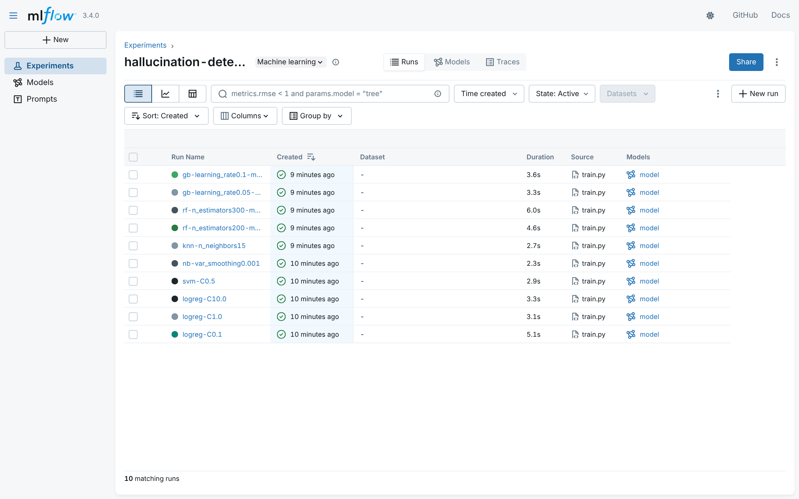
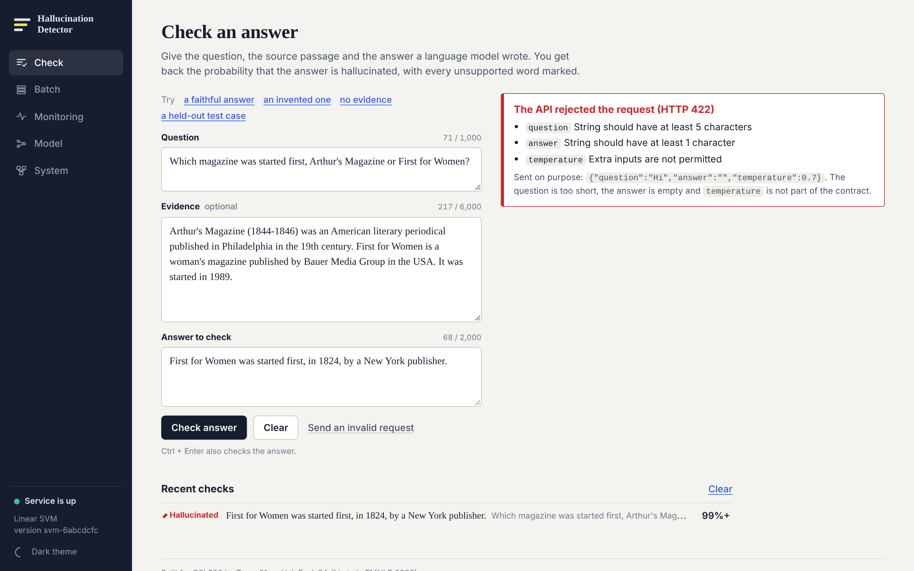
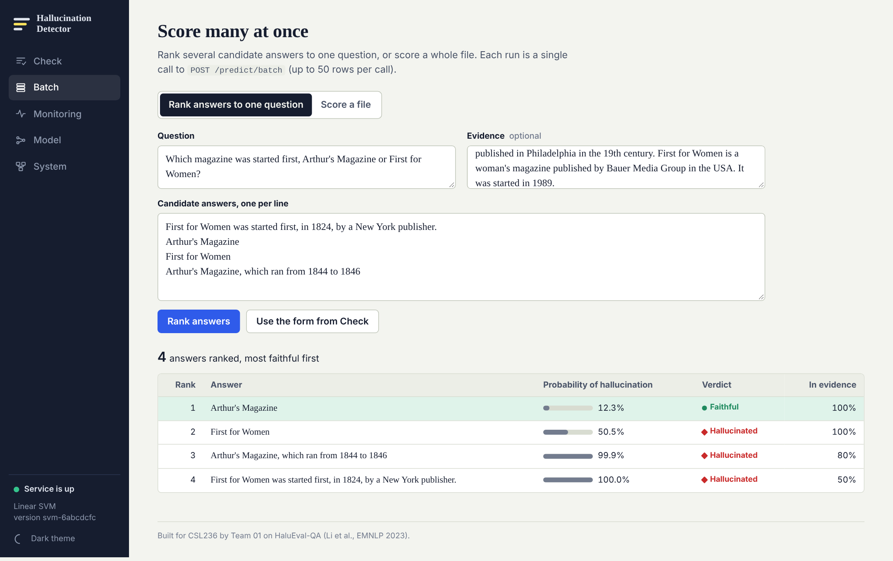
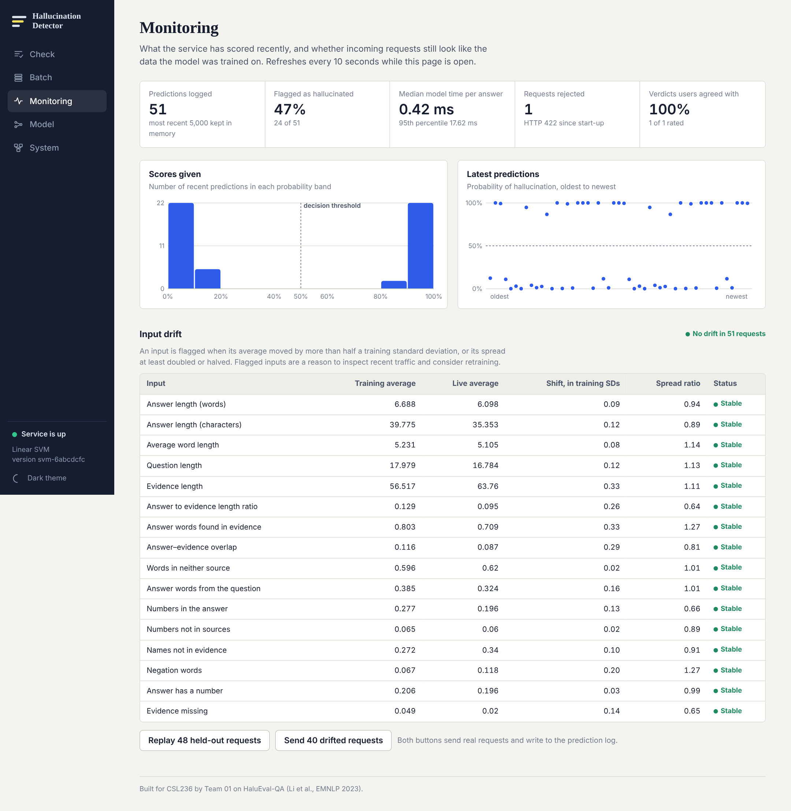
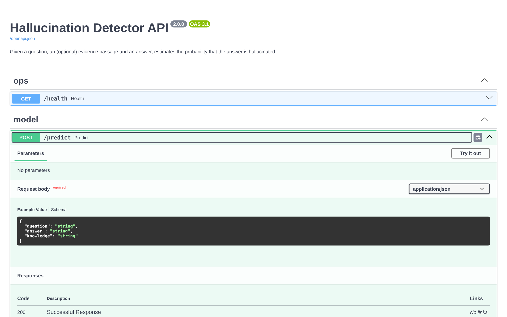

# Hallucination Detector - CSL236 End-Term Project (Team 01)

Ships the mid-term model (classical ML hallucination detection on HaluEval-QA) as a production-style ML system:
tracked experiments (MLflow), a validated FastAPI service with a five-page web interface, automated tests, a lean Docker image, CI on GitHub Actions,
cloud deployment config, request logging, Prometheus metrics, per-prediction explanations, a user-feedback loop and a live drift check.

| | |
|---|---|
| **Team** | 01 |
| **Members** | Bhavya Sangwan - 24CSU039, Rishika Sharma - 24CSU173 |
| **Course** | CSL236 - Introduction to AI and Machine Learning, B.Tech CSE, Semester 5, The NorthCap University |
| **GitHub repository** | _add link_ |
| **Live deployment** | _add public URL after deploying (see Deployment)_ |
| **Report** | `docs/BhavyaSangwan_24CSU039.pdf`, `docs/RishikaSharma_24CSU173.pdf` (same team report) |

## 1. Problem statement and dataset
Large language models sometimes give fluent answers that are not supported by facts (**hallucinations**). Given a **question**, an optional
**evidence passage** and an **answer**, the service returns the probability that the answer is hallucinated (binary classification, 1 = hallucinated).

**Dataset:** HaluEval-QA - Li, Cheng, Zhao, Nie, Wen (2023), *HaluEval: A Large-Scale Hallucination Evaluation Benchmark for Large Language Models*, EMNLP 2023,
<https://github.com/RUCAIBox/HaluEval> (`data/qa_data.json`, questions derived from HotpotQA). 6,000 questions are sampled (seed 42); each gives one faithful
(label 0) and one hallucinated (label 1) answer -> **12,000 rows, balanced**. `data/halueval_qa.csv` (5.9 MB) is committed; `python download_data.py` rebuilds it.
5 % of the questions have their evidence blanked (seeded **simulation** of a retrieval failure, documented in the mid-term notebook).
Pre-processing and evaluation were done in the mid-term notebook (stages A-H); this repo ships that model.
The train/test split (80/20) is **grouped by question** so both answers to one question are never on different sides, and it happens before anything is fitted.

### Data contract (enforced by the Pydantic schema - violations return HTTP 422)
**Request fields**

| Feature | Type | Allowed range / values | Why it matters |
|---|---|---|---|
| `question` | string | 5 - 1000 characters, not blank | Defines what a correct answer must contain; gives the question type and words to compare against |
| `answer` | string | 1 - 2000 characters, not blank | The text being checked: its length, wording and numbers are the strongest signals |
| `knowledge` | string or null | 0 - 6000 characters; null / blank = evidence unavailable | The evidence the answer should be grounded in; missing evidence is imputed and flagged |
| (any other field) | - | rejected (`extra = forbid`) | Prevents silently ignored typos |

**Engineered model features** (computed in `features.py` from the three fields; fitted steps are inside the sklearn pipeline)

| Feature | Type | Range / values | Why it matters |
|---|---|---|---|
| `ans_wc`, `ans_chars` | int | >= 0 | Hallucinated answers are full sentences (about 11 words) vs about 2 for faithful ones |
| `avg_wlen`, `q_wc`, `ctx_wc` | float / int | >= 0 (`ctx_wc` NaN if no evidence) | Style and size of answer, question and evidence |
| `len_ratio` | float | >= 0 | Answer length relative to the evidence |
| `ctx_support` | float | 0.0 - 1.0 (NaN if no evidence) | Share of the answer's key words found in the evidence: main grounding signal |
| `jaccard_ak` | float | 0.0 - 1.0 | Overlap between answer and evidence |
| `novel_content` | int | >= 0 | Answer words that appear in neither evidence nor question |
| `ans_in_q` | float | 0.0 - 1.0 | Share of the answer copied from the question |
| `n_numbers`, `unsup_numbers` | int | >= 0 | Numbers in the answer / numbers found nowhere in the inputs (invented dates, counts) |
| `novel_caps` | int | >= 0 | Capitalised names that appear in neither evidence nor question |
| `negations` | int | >= 0 | Negation words |
| `has_number`, `kn_missing` | int | {0, 1} | Answer contains a digit / evidence missing |
| `ans_len_cat` | ordinal | short < medium < long | Binned answer length |
| `qtype` | nominal | who, what, which, when, where, how, why, polar, other | Question type (one-hot) |
| `support_bin` | nominal | ungrounded (<=0.10), partial (0.10-0.90), full (>0.90), unknown | Binned grounding score; relation to the label is non-monotonic |
| `answer` (text) | text | - | TF-IDF 1-2-grams (Logistic Regression / SVM only) |
| `hallucination` (target) | binary | {0, 1} | Label |

## 2. Repository layout
```
data/halueval_qa.csv        dataset (download_data.py rebuilds it)
model/model.joblib          best model, loaded once at start-up
model/metadata.json         its parameters, metrics, confusion matrix and training statistics (used by the drift check)
model/experiments.json      the MLflow run table, exported so the MLflow-free serving image can show it
model/examples.json         24 held-out test cases for the interface
static/index.html           web interface (with styles.css and app.js; no external assets)
tests/test_app.py           pytest suite (24 test cases)
.github/workflows/ci.yml    GitHub Actions pipeline
app.py                      FastAPI app + Pydantic schema
features.py                 stateless feature engineering shared by train.py and app.py
train.py                    training script with MLflow tracking
download_data.py            builds the dataset from the official HaluEval file
drift_check.py              bonus: compares logged inputs with training data (CLI and GET /api/drift)
Dockerfile                  serving image (python:3.11-slim, requirements-serve.txt only)
requirements.txt            full dev/training environment
requirements-serve.txt      lean serving runtime (no MLflow / pytest)
render.yaml                 Render deployment blueprint
mlflow.db                   experiment history (committed so evaluators can open it)
docs/                       screenshots and a sample prediction log
```

## 3. Setup and run
**Local**
```bash
python3 -m venv venv && source venv/bin/activate
pip install -r requirements.txt
python train.py --algorithm gb --learning_rate 0.1 --max_leaf_nodes 31   # one tracked run (all hyper-parameters are CLI args)
python train.py --sweep                                                  # the 10 tracked runs in section 4
mlflow ui --backend-store-uri sqlite:///mlflow.db                        # http://localhost:5000
uvicorn app:app --reload --port 8000                                     # UI: http://localhost:8000  docs: /docs
pytest -v --tb=short
python drift_check.py                                                    # after some /predict traffic
```
`train.py` saves `model/model.joblib` only when the run has the best validation F1 so far (use `--force-save` to override). Default (no arguments) trains gradient boosting.

**Web interface** (served at `/`; three static files, no CDN, light and dark theme, works on a phone)

| Page | What it does |
|---|---|
| **Check** | Scores one answer. Shows the probability on a risk scale, a verdict stamp, the answer with every word marked (found in the evidence / only in the question / in neither / unknown name / unknown number), the evidence with reused words underlined, 2-3 rule-based tips, **why the model gave this score** (signed contribution of each feature group, expandable to single features and n-grams), a right/wrong feedback button, and the raw request and response. Includes a button that sends an invalid request to show the 422. |
| **Batch** | Ranks several candidate answers to one question, or scores a CSV / JSON file (up to 50 rows per API call) with a downloadable result and, if a `truth` column is present, the agreement rate. |
| **Monitoring** | Live counts, share flagged, latency, rejected requests, user-agreement rate, a histogram and a timeline of recent scores, and the input-drift table. Two buttons replay held-out requests or send drifted ones to demonstrate the drift check. |
| **Model** | Model card: test metrics, confusion matrix, the ten MLflow runs (chart and table), the largest model weights, the data contract read from the live schema, and known limits. |
| **System** | The pipeline from data to deployment, a live status check of every endpoint, and curl / Python snippets. |


**API**

| Method | Path | Purpose |
|---|---|---|
| GET | `/health` | liveness probe |
| POST | `/predict` | score one answer: probability, label, risk level, tips, signals, explanation, word marks |
| POST | `/predict/batch` | score 1-50 answers in one call |
| POST | `/feedback` | record whether a verdict was right (`prediction_id`, `correct`) |
| GET | `/api/stats`, `/api/drift` | live traffic statistics and drift report |
| GET | `/api/model`, `/api/examples` | model card and held-out examples |
| GET | `/metrics`, `/docs` | Prometheus metrics, interactive OpenAPI documentation |

**Docker**
```bash
docker build -t hallucination-detector .
docker run -d -p 8000:8000 --restart unless-stopped hallucination-detector
```
```bash
curl localhost:8000/health
curl -X POST localhost:8000/predict -H 'content-type: application/json' \
  -d '{"question":"Who wrote Pride and Prejudice?","knowledge":"Pride and Prejudice is an 1813 novel by Jane Austen.","answer":"Charlotte Bronte wrote it in 1847."}'
```
Invalid input (blank answer, question under 5 characters, wrong types, unknown fields, over-long text) returns **422**. Missing evidence (`null`, empty) is handled: the evidence features are median-imputed and `kn_missing` = 1.

## 4. MLflow experiment results
10 tracked runs, 6 algorithms (SQLite backend `mlflow.db`, experiment `hallucination-detection`). **Selection uses 3-fold grouped cross-validation F1 on the training split**;
test metrics are logged for reporting and were not used to choose the model.

| # | Run | Algorithm | Hyper-parameters | CV F1 (selection) | Test accuracy | Test F1 | Test ROC-AUC |
|---|---|---|---|---|---|---|---|
| 1 | logreg-C0.1 | logreg | C=0.1 | 0.9731 | 0.9688 | 0.9686 | 0.9933 |
| 2 | logreg-C1.0 | logreg | C=1.0 | 0.9785 | 0.9738 | 0.9736 | 0.9943 |
| 3 | logreg-C10.0 | logreg | C=10.0 | 0.9789 | 0.9712 | 0.9711 | 0.9944 |
| 4 | svm-C0.5 | svm | C=0.5 | 0.9796 | 0.9750 | 0.9748 | 0.9942 |
| 5 | nb-var_smoothing0.001 | nb | var_smoothing=0.001 | 0.9334 | 0.9283 | 0.9299 | 0.9778 |
| 6 | knn-n_neighbors15 | knn | n_neighbors=15 | 0.9676 | 0.9633 | 0.9635 | 0.9896 |
| 7 | rf-n_estimators200-max_depth8-min_samples_leaf1 | rf | n_estimators=200, max_depth=8, min_samples_leaf=1 | 0.9768 | 0.9729 | 0.9729 | 0.9947 |
| 8 | rf-n_estimators300-max_depth16-min_samples_leaf1 | rf | n_estimators=300, max_depth=16, min_samples_leaf=1 | 0.9781 | 0.9754 | 0.9753 | 0.9949 |
| 9 | gb-learning_rate0.05-max_leaf_nodes15 | gb | learning_rate=0.05, max_leaf_nodes=15 | 0.9786 | 0.9767 | 0.9766 | 0.9950 |
| 10 | gb-learning_rate0.1-max_leaf_nodes31 | gb | learning_rate=0.1, max_leaf_nodes=31 | 0.9777 | 0.9758 | 0.9757 | 0.9956 |



## 5. Which model and why
**Calibrated Linear SVM (C = 0.5)** has the best validation F1 (0.9796), trains in about a second, the saved model is under 0.1 MB, and its probabilities
come from `CalibratedClassifierCV`. It uses TF-IDF of the answer plus the engineered grounding/length features. Gradient boosting and random forest are within about 0.002
of it on test F1 (differences are smaller than the fold-to-fold noise), Gaussian NB and KNN are clearly weaker (independence assumption violated; distance
concentration). Choosing by validation rather than test score avoids tuning to the test set.
Honest caveat: part of the accuracy comes from a benchmark shortcut (ChatGPT hallucinations are full sentences, gold answers are short entities); without length features the
engineered features alone drop from 97.3 % to 94.3 % accuracy (see the mid-term notebook).

## 6. Testing
`pytest -v --tb=short` runs 24 test cases: health check, interface loads, response contract (2-3 tips, probability in [0, 1]), **two domain-logic tests**
(a short answer copied from the evidence scores lower than an answer with invented details; more unsupported detail raises risk), a parametrised **boundary test that expects 422**
(8 invalid payloads), missing-evidence handling (NaN-style input does not crash), prediction logging, the Prometheus endpoint, the explanation, batch scoring
(results equal single predictions; empty, oversized and invalid batches return 422), feedback (recorded; unknown id 404; wrong type 422), the statistics and drift reports, and the model card.


## 7. Docker, CI and deployment
* **Docker:** `python:3.11-slim`, installs `requirements-serve.txt` only, runs as non-root, has a HEALTHCHECK and honours `$PORT`. The model is loaded once at start-up in `app.py`.
  *Image size: measure with `docker images hallucination-detector` and note it here* (a local serve-only install of the same requirements is about 330 MB; expect an image of roughly 450-550 MB).
* **CI (`.github/workflows/ci.yml`)** on every push to `main`: install -> train a baseline model (`logreg`, `--force-save`) -> `pytest` -> build the Docker image -> smoke-test the container (health 200, invalid input 422) -> optional deploy hook.
* **Deployment (Render free tier, Docker runtime):** push the repo to GitHub, Render -> *New* -> *Blueprint* -> select the repo (`render.yaml`). Alternatives: Railway, or AWS EC2 `t3.micro` with
  `docker run -d -p 80:8000 --restart unless-stopped hallucination-detector`. For the bonus CD step add the Render *Deploy Hook* URL as the GitHub secret `RENDER_DEPLOY_HOOK`.
* **Logging and monitoring:** every prediction appends a JSON line (timestamp, id, probability, label, latency, the 16 numeric input features; never the raw text) to `logs/predictions.jsonl` (see `docs/sample_predictions.jsonl`);
  user feedback goes to `logs/feedback.jsonl`. Prometheus metrics at `/metrics` (`predictions_total`, `prediction_latency_seconds`, `validation_errors_total`, `feedback_total`). The Monitoring page reads `/api/stats` and `/api/drift`.
  On hosts with ephemeral disks mount a volume or ship the log elsewhere.
* **Explainability (bonus):** `/predict` returns the signed contribution of each feature group to the score (weight x value for the linear models; an occlusion fallback for tree models), shown on the Check page.
* **Drift check (bonus):** `python drift_check.py` (and `GET /api/drift`, same function) compares mean/std of logged features with the training statistics stored in `model/metadata.json` and flags features whose mean moved more than
  0.5 training standard deviations or whose spread changed more than 2x. Drift (or a falling share of confident predictions) is the trigger to re-run `train.py` on fresh labelled data.

## 8. Screenshots
| | |
|---|---|
| Interface, Check page |  |
| Invalid input rejected with 422 |  |
| Batch ranking |  |
| Monitoring and drift |  |
| Model card |  |
| `/docs` |  |
| MLflow UI |  |
| pytest |  |
| Green CI check | _add a screenshot of the latest green GitHub Actions run after pushing_ |

## 9. Limitations and next steps
Length/style shortcut of the benchmark; lexical grounding cannot catch a wrong answer that reuses the evidence's own words (a natural-language-inference or fine-tuned transformer model would); 5 % missing evidence is simulated;
single task (HaluEval-QA); statistics are kept in memory per process and the log file is lost on hosts with ephemeral disks. Next: NLI cross-encoder feature, retrieval so no gold evidence is needed, automatic retraining when drift is flagged or user agreement falls, MLflow Model Registry promotion gates.

## 10. Team contribution
| Member | Roll no. | Contribution |
|---|---|---|
| Bhavya Sangwan | 24CSU039 | Data preparation and feature engineering (`download_data.py`, `features.py`), training script and MLflow tracking (`train.py`), model comparison and selection, drift check (`drift_check.py`), report |
| Rishika Sharma | 24CSU173 | FastAPI service and data contract (`app.py`), web interface (`static/`), pytest suite, Dockerfile, GitHub Actions workflow and deployment, presentation |
| Both | | EDA and the mid-term notebook, README, demo and viva preparation |

_Proposed split: edit it to match what each member actually did, and make sure each member's commits cover their part._

## 11. References
Li et al. (2023) HaluEval, EMNLP; Yang et al. (2018) HotpotQA; Pedregosa et al. (2011) scikit-learn; Zaharia et al. MLflow (<https://mlflow.org>); FastAPI (<https://fastapi.tiangolo.com>);
Brainmentors *End-to-End MLOps: Production Deployment* workshop (reference architecture).
